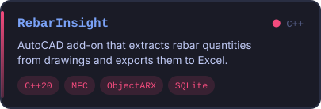
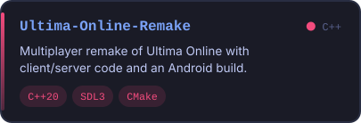
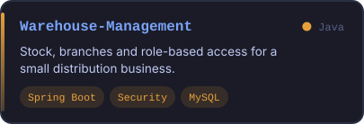
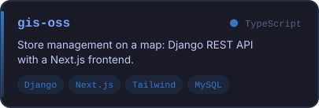
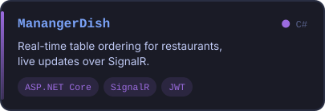
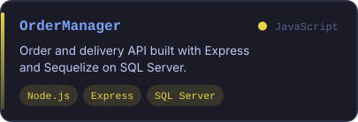
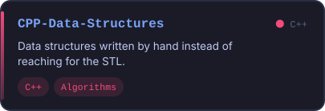
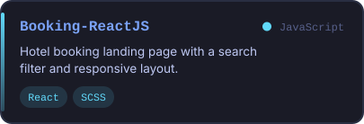

  

  Mình là Trọng, đang học CNTT. Hay viết C++ nhất, còn lại chủ yếu là bài tập trên lớp với mấy thứ làm cho vui. 
  Repo bên dưới có cái làm tới nơi, có cái bỏ dở giữa chừng. Mình không dọn, để đó cho nhớ mình đã học được gì.

  Dạo này đang mày mò plugin AutoCAD (ObjectARX), game SDL3 và web bản đồ cho môn GIS. 
  Đang tìm chỗ thực tập backend hoặc C++. Cần gì cứ nhắn mình qua GitHub.

🇬🇧 English

 

  I'm Trong, studying IT. I write C++ the most; the rest is mostly coursework and things I built for fun. 
  Some repos below got finished, some I dropped halfway. I haven't cleaned them up, they're a record of what I picked up.

  Lately: an AutoCAD plugin (ObjectARX), an SDL3 game, and a map-based web app for a GIS course. 
  Looking for a backend or C++ internship.

  

  
  
  
  
  
  
  
  

  
  

  

